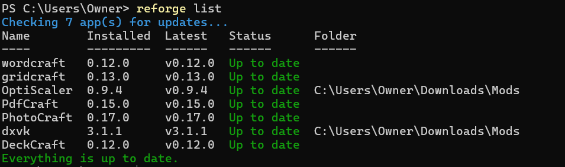

<p align="center">
  <picture>
    <source media="(prefers-color-scheme: dark)" srcset="assets/reforge-logo-dark.svg">
    
  </picture>
</p>

<p align="center">
  <b>A package manager for GitHub releases.</b><br>
  Install and update any app or game mod straight from its GitHub releases.<br>
  No catalog, no waiting for someone to package it.
</p>

<p align="center">
  <a href="https://github.com/VGRichi/Reforge/releases/latest"></a>
  <a href="https://github.com/VGRichi/Reforge/actions/workflows/test.yml"></a>
  <a href="LICENSE"></a>
</p>

## Features

- **Downloads and installs apps** straight from a GitHub repository's latest release
- **Keeps them up to date**: installed apps (`.msi` / `.exe`) update silently, with the right installer for your PC (x64 or ARM64)
- **Keeps downloaded mods and tools up to date**, like DXVK and OptiScaler (`.zip` / `.7z` / `.tar.gz`): new versions are downloaded next to the old ones, and extracted too if you extracted the old one
- **Can also copy them into your game folders** on every update, with backups and without touching your settings
- **Finds what you already have**: installed apps that link to GitHub, and GitHub downloads in your Downloads folder
- **Verifies every download** against GitHub's SHA256 checksums and installers' digital signatures, and never installs an unverified file without asking
- **One small program**, nothing else to install

Installer apps are Windows-only for now; game mods and tools work on Windows, macOS and Linux.
<p align="center">
  
</p>

## Install

Download the file for your system from the [latest release](https://github.com/VGRichi/Reforge/releases/latest), extract it, and put `reforge` in a folder on your `PATH`.

| System | Download |
|---|---|
| Windows (x64) | [reforge_windows_amd64.zip](https://github.com/VGRichi/Reforge/releases/latest/download/reforge_windows_amd64.zip) |
| Windows (ARM) | [reforge_windows_arm64.zip](https://github.com/VGRichi/Reforge/releases/latest/download/reforge_windows_arm64.zip) |
| macOS (Apple Silicon) | [reforge_darwin_arm64.tar.gz](https://github.com/VGRichi/Reforge/releases/latest/download/reforge_darwin_arm64.tar.gz) |
| macOS (Intel) | [reforge_darwin_amd64.tar.gz](https://github.com/VGRichi/Reforge/releases/latest/download/reforge_darwin_amd64.tar.gz) |
| Linux (x64) | [reforge_linux_amd64.tar.gz](https://github.com/VGRichi/Reforge/releases/latest/download/reforge_linux_amd64.tar.gz) |
| Linux (ARM) | [reforge_linux_arm64.tar.gz](https://github.com/VGRichi/Reforge/releases/latest/download/reforge_linux_arm64.tar.gz) |

Each release has a `checksums.txt` with the SHA256 of every file. On an ARM PC, use the ARM download so Reforge picks ARM installers.

**With Go:** `go install github.com/VGRichi/Reforge/cmd/reforge@latest`

<details>
<summary>Install from the terminal</summary>

Windows (PowerShell), into your user's programs folder and `PATH`:

```powershell
$dir = "$env:LOCALAPPDATA\Programs\Reforge"
Invoke-WebRequest https://github.com/VGRichi/Reforge/releases/latest/download/reforge_windows_amd64.zip -OutFile "$env:TEMP\reforge.zip"
Expand-Archive "$env:TEMP\reforge.zip" $dir -Force
[Environment]::SetEnvironmentVariable('Path', [Environment]::GetEnvironmentVariable('Path', 'User') + ";$dir", 'User')
```

macOS and Linux (change `linux_amd64` to match your system):

```sh
mkdir -p ~/.local/bin
curl -L https://github.com/VGRichi/Reforge/releases/latest/download/reforge_linux_amd64.tar.gz | tar -xz -C ~/.local/bin reforge
```

</details>

## Usage

```sh
reforge add                 # find what's on your PC from GitHub, and pick what to track
reforge add dxvk            # track an app, mod or tool by name (installs it if it isn't installed yet)
reforge list                # what you track, and which have updates
reforge update              # install the updates
reforge remove dxvk         # stop tracking (doesn't uninstall)
```

Every command has `--help` with all its options, like `--prerelease` to follow beta releases, `--pattern` to pick the release file yourself, or `--json` for scripts. Apps installed for all users need an administrator terminal. GitHub allows 60 checks an hour without signing in, and Reforge reuses each check for an hour; for 5,000 an hour, sign in with the [GitHub CLI](https://cli.github.com) (`gh auth login`), which Reforge uses automatically, or set `GITHUB_TOKEN` to a [GitHub token](https://github.com/settings/tokens).

## Security

- **With a GitHub checksum:** verified, then installed. If it doesn't match, nothing is installed.
- **Without one:** you're asked: **Yes**, **Always** (trust this app), or **No**. If the app's earlier releases had checksums, it always asks.
- **Size:** a download that isn't the size GitHub lists is broken, and nothing is installed.
- **Digital signature:** a signed installer whose signature is broken (changed after signing) is never installed. Reforge remembers who signs each app; if a release is suddenly signed by someone else, or not signed any more, it warns and asks.
- **Archives:** nothing is extracted outside its folder, links are refused, and an archive that unpacks to far more than its size (a zip bomb) is rejected.
- **Nobody to ask** (a scheduled task): the answer is No.

A checksum proves you got exactly the file on the release page, and a signature that the developer made it, but neither proves the app is safe. Only track apps from developers you trust. DLL mods can trigger anti-cheat in online games.

## Limitations

- Versions are compared by number, so `1.2.0-beta3` → `1.2.0-beta4` isn't seen as an update.
- Mods and tools copied into game folders (`--dest`) aren't tracked by the OS, so their first update installs the latest release.

## License

[MIT](LICENSE). Want to help? See [CONTRIBUTING.md](CONTRIBUTING.md).
